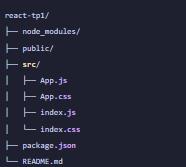
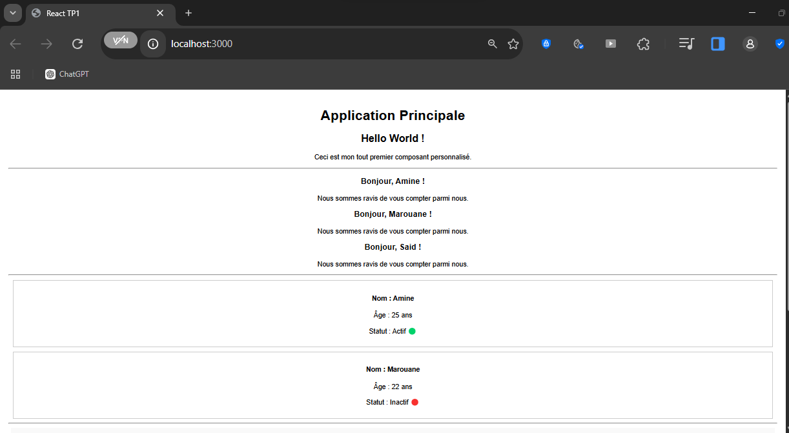
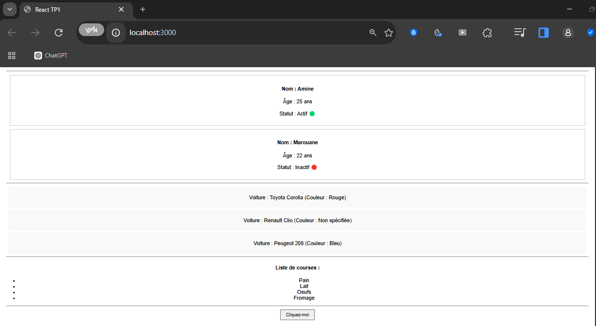
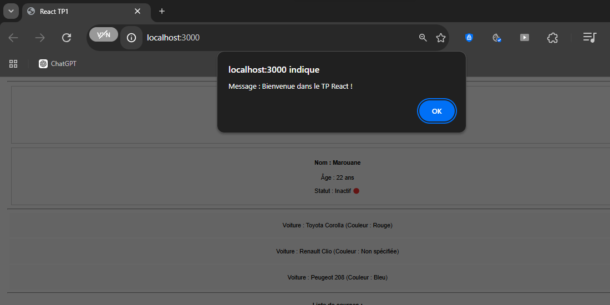

# React TP1 : composants, props et PropTypes

Petite application React réalisée dans le cadre du premier TP. Elle regroupe dans une seule page tous les composants vus pendant la séance : un composant simple, des composants qui reçoivent des props, la validation de ces props avec PropTypes, l'affichage d'une liste et la gestion d'un clic.

## Ce que le projet démontre

- la création d'un projet React et son organisation en composants fonctionnels
- le passage de données d'un composant parent vers un enfant avec les props
- la validation des types avec la bibliothèque `prop-types`
- l'affichage d'un tableau avec `map()` et l'attribut `key`
- la gestion d'un événement avec `onClick`

## Prérequis

- Node.js (version LTS, 16 ou plus)
- npm
- un éditeur de code, par exemple Visual Studio Code

Pour vérifier l'installation :

```bash
node -v
npm -v
```

## Installation et lancement

Depuis le dossier du projet :

```bash
npm install
npm start
```

L'application s'ouvre automatiquement sur `http://localhost:3000`. Si ce n'est pas le cas, il suffit de taper l'adresse dans le navigateur. Pour arrêter le serveur, utiliser `Ctrl + C` dans le terminal.


## Structure du projet



## Les composants

| Composant | Rôle | Props |
|---|---|---|
| `HelloWorld` | Affiche un message fixe, sans donnée extérieure | aucune |
| `Greeting` | Salue une personne par son prénom | `prenom` |
| `Profil` | Fiche utilisateur avec nom, âge et statut | `nom` (string, requis), `age` (number, requis), `estActif` (bool) |
| `Voiture` | Affiche marque, modèle et couleur | `marque` (string, requis), `modele` (string, requis), `couleur` (string, valeur par défaut "Non spécifiée") |
| `ListeCourses` | Affiche une liste à puces à partir d'un tableau | `items` (tableau de string, requis) |
| `BoutonAlerte` | Bouton qui ouvre une alerte au clic | `message` |

`App.js` assemble l'ensemble et fournit les valeurs de test.

## Tester la validation PropTypes

Dans `App.js`, remplacer par exemple `age={25}` par `age="25"` pour un composant `Profil`. Après sauvegarde, la console du navigateur (touche F12) affiche un avertissement indiquant que la prop `age` attendait un nombre et a reçu une chaîne.

## Exécution

### Affichage de l'application

Haut de la page : composant `HelloWorld`, trois `Greeting` et deux `Profil`.



Bas de la page : les trois `Voiture` (la Renault Clio utilise la couleur par défaut), la `ListeCourses` et le bouton.



### Clic sur le bouton

Le composant `BoutonAlerte` affiche le message reçu en prop.



